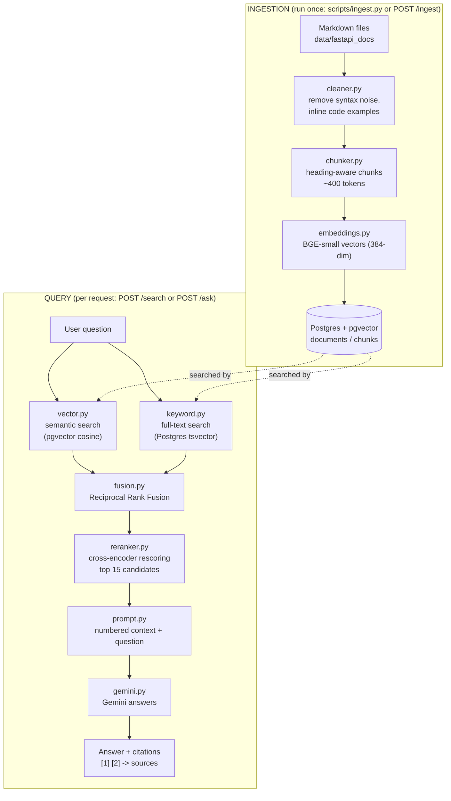
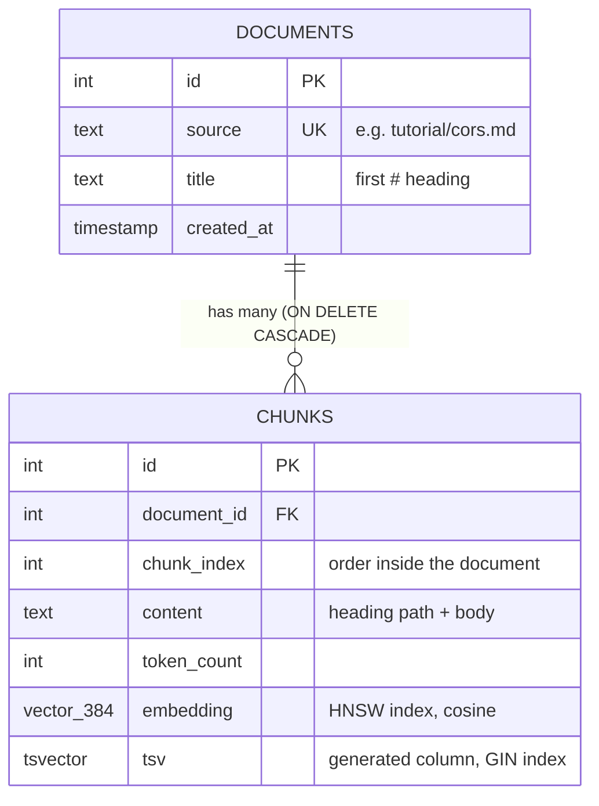
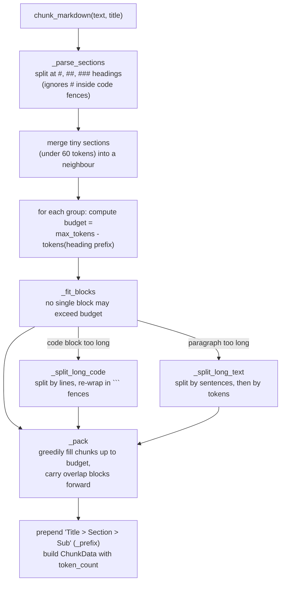
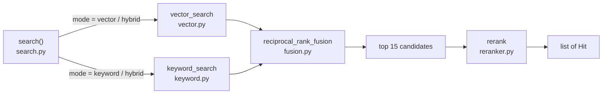
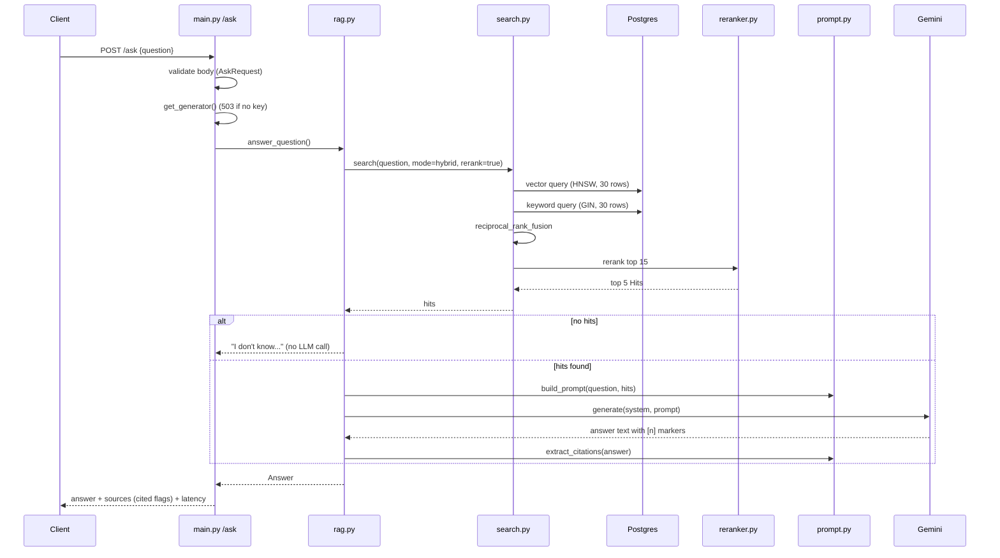
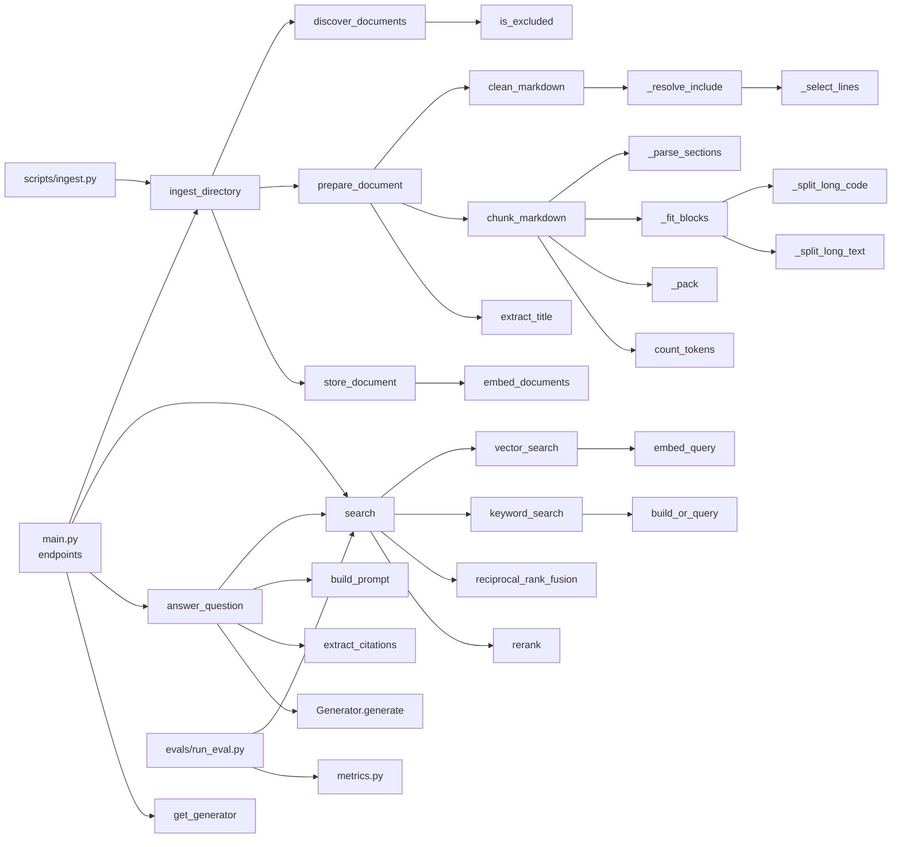

# RAG Project: Complete Guide

A Retrieval-Augmented Generation (RAG) system over the FastAPI documentation, built from scratch with no LangChain or LangGraph. It exists so you can explain every layer (cleaning, chunking, embedding, hybrid retrieval, reranking, grounded generation, evaluation) in an interview.

The diagrams use Mermaid. They render on GitHub, in VS Code (Markdown Preview Mermaid Support extension) and in most Markdown viewers.

---

## 1. What problem does this solve?

An LLM does not know your documents and may invent answers. RAG fixes that in two steps:

1. **Retrieve**: find the few passages of your documents most relevant to the question.
2. **Generate**: give those passages to the LLM and tell it to answer only from them, citing which passage supports each claim.

The work is split into two pipelines:

- **Ingestion (offline, once)**: turn the docs into searchable chunks stored in Postgres.
- **Query (online, per question)**: search, rerank, build a prompt, call Gemini, return the answer with citations.

---

## 2. Big picture



---

## 3. Project structure

```
RAG_Project/
├── app/
│   ├── main.py                  FastAPI app and all HTTP endpoints
│   ├── config.py                every setting, loaded from .env
│   ├── db.py                    SQLAlchemy engine, session factory, Base
│   ├── models.py                Document and Chunk tables
│   ├── schemas.py               Pydantic request/response models
│   ├── embeddings.py            text -> vector (BGE-small)
│   ├── ingestion/
│   │   ├── cleaner.py           markdown -> clean text, inlines code
│   │   ├── chunker.py           clean text -> sized chunks
│   │   └── pipeline.py          orchestrates clean -> chunk -> embed -> store
│   ├── retrieval/
│   │   ├── types.py             the Hit dataclass
│   │   ├── vector.py            semantic search
│   │   ├── keyword.py           keyword search
│   │   ├── fusion.py            Reciprocal Rank Fusion
│   │   ├── reranker.py          cross-encoder reranking
│   │   └── search.py            the search() entry point that combines all of it
│   └── generation/
│       ├── prompt.py            prompt building, citation parsing
│       ├── gemini.py            Gemini client wrapper
│       └── rag.py               answer_question(): retrieve + generate
├── scripts/ingest.py            command-line ingestion
├── evals/
│   ├── dataset.json             40 questions with the expected source page
│   ├── metrics.py               recall@k, MRR, percentiles
│   ├── run_eval.py              runs 4 retrieval configurations and prints a table
│   ├── run_answer_eval.py       end-to-end answer check with real Gemini (free-tier friendly)
│   ├── results.json             last retrieval evaluation output
│   ├── answer_results.json      last answer evaluation output (created by the script)
│   └── answer_checkpoint.json   saved answers so an interrupted run can resume
├── tests/                       71 tests (unit + integration)
├── docker-compose.yml           Postgres + pgvector container
├── pytest.ini                   test configuration
├── requirements.txt
├── .env / .env.example          configuration values
└── data/
    ├── fastapi_docs/            the markdown corpus
    └── docs_src/                code examples referenced by the docs
```

---

## 4. Database design



Why each part exists:

- **`embedding vector(384)`** with an **HNSW index** (`vector_cosine_ops`): approximate nearest-neighbour search, so semantic lookups stay fast as data grows.
- **`tsv` generated column** with a **GIN index**: Postgres computes `to_tsvector('english', content)` automatically and keeps it in sync. It powers keyword search.
- **`ON DELETE CASCADE`**: deleting a document removes its chunks, which makes re-ingestion simple.
- **`source` is unique**: one row per file, so re-ingesting replaces rather than duplicates.

---

## 5. File-by-file reference

### 5.1 `app/config.py`

Defines `Settings` (pydantic-settings). Values come from environment variables first, then from `.env`. Everything tunable lives here so no number is hard-coded in the logic.

| Setting | Default | Meaning |
|---|---|---|
| `database_url` | from `.env` | Postgres connection string |
| `embedding_model` | `BAAI/bge-small-en-v1.5` | model that turns text into vectors |
| `embedding_batch_size` | 32 | texts embedded per forward pass |
| `query_instruction` | BGE prefix | prepended to queries only (BGE is trained this way) |
| `chunk_max_tokens` | 400 | hard ceiling per chunk, heading prefix included |
| `chunk_overlap_tokens` | 50 | overlap between consecutive chunks of one section |
| `chunk_min_tokens` | 60 | sections smaller than this get merged with a neighbour |
| `docs_dir`, `docs_src_dir` | `data/...` | where the markdown and code examples live |
| `excluded_docs` | `release-notes.md`, `reference/`, `_llm-test.md` | pages skipped during ingestion |
| `retrieval_candidates` | 30 | how many results each retriever returns before fusion |
| `rrf_k` | 60 | the RRF damping constant |
| `top_k` | 5 | final results returned |
| `reranker_model` | `cross-encoder/ms-marco-MiniLM-L-6-v2` | rescoring model |
| `rerank_enabled` | true | rerank by default |
| `rerank_candidates` | 15 | how many fused candidates go through the reranker |
| `gemini_api_key` | empty | read from `GEMINI_API_KEY` in `.env`; never commit it |
| `gemini_model` | `gemini-3.5-flash` | override with `GEMINI_MODEL` in `.env` |
| `gemini_timeout_seconds` | 45 | per-request timeout |
| `gemini_retry_attempts` | 2 | attempts the Gemini client makes per call |
| `max_context_chunks` | 5 | most passages sent to the LLM |

`PROJECT_ROOT` is computed from the file location, so the app finds `.env` and `data/` no matter which directory you start it from.

### 5.2 `app/db.py`

- `Base`: parent class of all ORM models.
- `engine`: owns the Postgres connection pool.
- `SessionLocal`: factory for sessions (`autoflush=False` so nothing is sent to the DB unexpectedly).
- `get_db()`: FastAPI dependency. Yields a session per request and always closes it.

### 5.3 `app/models.py`

`Document` and `Chunk` as described in section 4. `Chunk.__table_args__` declares the three indexes (document_id, HNSW on embedding, GIN on tsv). `EMBEDDING_DIM = 384` must match the embedding model.

### 5.4 `app/schemas.py`

Pydantic models define what the API accepts and returns. They also enforce limits, so bad input is rejected with HTTP 422 before any code runs:

- `SearchRequest`: `query` (1 to 1000 chars), `top_k` (1 to 20), `mode` (`vector`, `keyword` or `hybrid`), `rerank` (bool).
- `AskRequest`: `question`, `top_k` (1 to 10), `mode`, `rerank`.
- `HitOut`, `SearchResponse`, `SourceOut`, `AskResponse`, `IngestRequest`, `IngestResponse`, `StatsResponse`: response shapes. `SourceOut.cited` marks whether the answer actually cited that passage.

### 5.5 `app/embeddings.py`

- `get_model()`: loads the BGE model once and caches it (`lru_cache`).
- `embed_documents(texts)`: embeds a batch of chunks. Vectors are **normalized**, so cosine similarity equals the dot product.
- `embed_query(query)`: embeds one question **with the BGE instruction prefix**. Documents get no prefix. This asymmetry is what the model was trained for.

### 5.6 `app/ingestion/cleaner.py`

Turns FastAPI's raw markdown into clean text. Without this, embeddings would be polluted by syntax like `{ #anchor }` and `/// tip`.

| Function | What it does |
|---|---|
| `_strip_frontmatter` | removes a leading `---` YAML block |
| `_admonition_label` | converts a `/// tip` or `/// note \| Title` opener into a readable `Tip:` or `Note - Title:` |
| `_select_lines` | applies an `ln[19:21]` line range to a code file |
| `_resolve_include` | for `{* ../../docs_src/x.py ln[..] title["a.py"] *}`, finds the file, selects lines, returns language, code, title (or `None` if missing) |
| `clean_markdown` | the main loop, see below |

`clean_markdown` walks line by line, tracking whether it is inside a code fence:

- Inside code: keep the code as is (except include placeholders, which are replaced by the real file contents, and terminal colour tags in `console` blocks).
- Outside code: expand includes into real fenced code blocks, convert admonitions, strip heading anchors, drop images, keep link text but drop URLs, remove HTML tags. Finally collapse runs of blank lines.

### 5.7 `app/ingestion/chunker.py`

The most important file for interviews. **Chunking** is how you cut a document into retrievable pieces. Too big and the embedding blurs many topics; too small and context is lost.

Strategy: heading-aware, at most 400 tokens, 50-token overlap, never split a code block, always prefix the heading path.



| Function | Responsibility |
|---|---|
| `get_tokenizer()` | cached tokenizer of the embedding model. Sizes are measured in the model's own tokens, so "400" is real |
| `count_tokens(text)` | token count of a string |
| `_parse_sections(text, fallback_title)` | splits on `#`, `##`, `###`; builds the heading path (`["Guide","First"]`); groups lines into blocks (paragraphs, or whole fenced code blocks). Tracks `in_code` so `# comment` inside code is not read as a heading |
| `_split_long_text(text, budget)` | splits an oversized paragraph at sentence or line ends; a single over-long sentence is cut by token ids |
| `_split_long_code(block, budget)` | splits an oversized code block at line boundaries and re-wraps each part in its own fence so no chunk has an unbalanced fence. A single line larger than the budget (for example a long base64 string) is cut by tokens |
| `_fit_blocks(blocks, budget)` | passes small blocks through and routes oversized ones to the two splitters above |
| `_pack(blocks, budget, overlap)` | greedy packing. When a chunk is full, the last blocks that fit in `overlap` tokens are carried into the next chunk. Overlap is block-level, so overlaps never cut a sentence |
| `_prefix(path)` | `"Title > Section > Sub\n\n"` |
| `chunk_markdown(...)` | the orchestrator that returns `list[ChunkData]` |
| `ChunkData` | `chunk_index`, `heading_path`, `content`, `token_count` |

Why prepend the heading path? A chunk like "Set `allow_origins`..." is ambiguous alone. With "CORS > Use CORSMiddleware" in front, both the embedding and the keyword index know what it is about.

Result on the real corpus: 1265 chunks from 133 files, largest chunk exactly 400 tokens, none over, no split code fences.

### 5.8 `app/ingestion/pipeline.py`

Connects cleaner, chunker, embeddings and the database.

| Function | Responsibility |
|---|---|
| `is_excluded(path, excluded)` | `reference/` style entries match by prefix, others by exact path |
| `discover_documents(root)` | sorted list of `.md` files minus exclusions |
| `extract_title(cleaned, fallback)` | first `# ` heading, or the file name |
| `prepare_document(path, root, docs_src_dir)` | read, clean, title, chunk. No database involved, so it is easy to test |
| `store_document(session, source, title, chunks)` | **deletes the document's old row (cascading to its chunks)**, inserts the new document, embeds all chunks in one batch, inserts chunk rows |
| `ingest_directory(session, ...)` | loops over files, commits per document, and on a full run deletes documents whose files no longer exist. Returns an `IngestReport` |

This makes ingestion **idempotent**: running it twice gives the same database, and edited files fully replace their old chunks. A run with `limit` never deletes other documents.

### 5.9 `app/retrieval/`



- **`types.py`: `Hit`**: one search result (`chunk_id`, `source`, `title`, `chunk_index`, `content`, `score`). All retrievers return the same type, which is why they can be combined.
- **`vector.py`: `vector_search`**: embeds the query, orders chunks by cosine distance using pgvector (served by the HNSW index), and returns `score = 1 - distance`. It finds meaning ("allow requests from other domains" finds CORS).
- **`keyword.py`**:
  - `build_or_query(query)`: extracts words, lowercases, de-duplicates, joins with `|`. An OR query is used because a natural-language question joined with AND would match almost nothing.
  - `keyword_search`: runs `to_tsquery` and ranks with `ts_rank_cd`. It is great for exact terms such as `CORSMiddleware`.
- **`fusion.py`: `reciprocal_rank_fusion(rankings, k)`**: each item scores `sum(1 / (k + rank))` over the lists it appears in. It uses ranks, not raw scores, which matters because cosine similarity and ts_rank are on different scales and cannot be added. Ties break by `chunk_id`, so output is deterministic.
- **`reranker.py`: `rerank(query, hits, top_k)`**: a cross-encoder reads the query and each chunk together and gives a relevance score. That is more accurate than comparing two independent vectors, but slower, so it only runs on the top 15 candidates.
- **`search.py`: `search(session, query, top_k, mode, use_rerank)`**: the single entry point. Used by `/search`, `/ask` and the evaluation.

Bi-encoder versus cross-encoder, for interviews: a bi-encoder (BGE) embeds query and document separately, so document vectors are precomputed and search is fast. A cross-encoder processes the pair jointly, which is more precise but must run per pair at query time.

### 5.10 `app/generation/`

- **`prompt.py`**
  - `SYSTEM_INSTRUCTION`: answer only from the numbered passages, cite as `[1]`, say "I don't know based on the provided documentation" if the answer is absent.
  - `build_prompt(question, hits)`: formats `[1] (source: x.md)\n<content>` blocks followed by the question.
  - `extract_citations(answer, total)`: finds `[n]` markers, ignores out-of-range numbers (a model can hallucinate `[9]`), returns them in order without duplicates.
- **`gemini.py`**
  - `GenerationUnavailable`: raised when no API key is set, Gemini returns nothing, or Gemini returns an API error (429 quota, 503 overloaded, 504 timeout). Wrapping upstream errors in one exception type lets the API turn them into a clean 503.
  - `Generator` (Protocol): the interface `generate(system_instruction, prompt) -> str`. Anything with that method works, which is how tests use a fake.
  - `GeminiGenerator`: wraps the `google-genai` client (temperature 0.2) with a request timeout and a bounded retry count, so a stalled call cannot hang for minutes.
  - `get_generator()`: builds a `GeminiGenerator`.
- **`rag.py`**: `answer_question(...)` runs `search`, returns "I don't know" without calling the LLM when nothing was retrieved, otherwise builds the prompt, calls the generator and returns an `Answer` (`answer`, `sources`, `cited`).

### 5.11 `app/main.py` (HTTP layer)

| Endpoint | Purpose |
|---|---|
| `GET /health` | runs `SELECT 1`, returns 503 if the database is down |
| `GET /stats` | number of documents and chunks |
| `POST /ingest` | runs ingestion (optional `{"limit": n}`) |
| `POST /search` | retrieval only: results with scores and latency |
| `POST /ask` | full RAG: answer, sources, which sources were cited, latency |

The `lifespan` hook runs at startup: enables the `vector` extension, creates tables, and **loads the embedding model and the reranker**, so the first request is not slow. `/ask` creates the Gemini client inside the handler, after request validation, so an invalid request gets 422 even when no key is configured. If Gemini fails (rate limit, overload, timeout), `/ask` returns 503 with a short reason instead of a raw 500.

### 5.12 `scripts/ingest.py`

Command-line ingestion: `python scripts/ingest.py` (add `--limit 5` to try a few files). It creates the extension and tables, runs `ingest_directory`, and prints counts and time.

### 5.13 `evals/`

- `dataset.json`: 40 questions, each with the page(s) that should contain the answer.
- `metrics.py`: `first_relevant_rank`, `recall_at_k`, `mean_reciprocal_rank`, `percentile`, `is_refusal`, `cited_expected_source`.
- `run_eval.py`: runs four configurations over all questions, writes `results.json` and prints a table.
- `run_answer_eval.py`: end-to-end check with the real Gemini model on 14 in-scope questions (every third question of the dataset) and 4 off-topic questions. It is built for the Gemini **free tier**: one request every 13 seconds (about 4 per minute), up to 4 attempts per question with a 60-second wait after a rate-limit or overload error, and a checkpoint file so an interrupted run resumes without repeating answered questions (`--fresh` starts over).

Metric definitions:

- **recall@k**: share of questions where a correct page appears in the top k (results are de-duplicated by page first).
- **MRR**: average of `1 / rank of the first correct page`. 1.0 means always first.
- **p50 / p95 latency**: median and 95th-percentile retrieval time.
- **answer_rate**: share of in-scope questions where the model answered instead of refusing.
- **citation_rate**: share of answers that contain at least one valid `[n]` citation.
- **cited_expected_source_rate**: share of answers whose cited passage comes from the expected page. This checks that the citation points at the right source, not just that a citation exists.
- **off_topic_refusal_rate**: share of off-topic questions (capital of France, baking bread, and so on) that the model refuses with "I don't know based on the provided documentation". High is good: it shows the model stays inside the documentation.

---

## 6. End-to-end flow of one `/ask` request



---

## 7. Function dependency map



---

## 8. Design decisions and why

| Decision | Reason |
|---|---|
| No LangChain | frameworks hide chunking, retrieval and reranking, which are what interviewers ask about |
| Postgres + pgvector (not a separate vector DB) | one system for vectors, keyword search and relational data; hybrid search is two SQL queries |
| BGE-small-en-v1.5 | 384 dims (small, fast), 512-token limit so 400-token chunks are never truncated (MiniLM's 256-token limit would truncate them) |
| Measure chunks with the model's tokenizer | "400 tokens" then means the same thing the embedder sees |
| Heading-aware chunks with a heading path | preserves document structure and gives each chunk context |
| Never split inside code fences | half a code block is useless and breaks formatting |
| HNSW index, cosine ops | fast approximate search; matches normalized embeddings |
| OR keyword query | natural-language questions would match nothing under AND |
| RRF | combines rankings without needing comparable scores |
| Cross-encoder rerank on top 15 only | accuracy where it matters, bounded latency |
| Idempotent ingestion | safe to re-run after editing docs |
| Citations parsed and validated | `cited` flags are honest and hallucinated numbers are ignored |
| Generator as a Protocol | tests and future providers plug in without changing `rag.py` |
| Excluded `release-notes.md`, `reference/`, `_llm-test.md` | auto-generated or repetitive pages that would crowd out real answers (configurable in `config.py`) |

---

## 9. Evaluation results

Measured on the real corpus (1265 chunks), 40 questions, CPU only:

| Config | recall@1 | recall@3 | recall@5 | MRR | p50 latency | p95 latency |
|---|---|---|---|---|---|---|
| vector | 0.900 | 1.000 | 1.000 | 0.942 | 64 ms | 126 ms |
| keyword | 0.600 | 0.850 | 0.900 | 0.723 | 20 ms | 29 ms |
| hybrid (RRF) | 0.750 | 0.925 | 1.000 | 0.845 | 94 ms | 147 ms |
| hybrid + rerank | 0.925 | 0.975 | 0.975 | 0.949 | 2209 ms | 2455 ms |

What to take from this (honest reading):

- **Vector search is already strong** on this corpus because the questions are natural language and the docs are well written.
- **Keyword alone is weak** for natural-language questions: common words such as "how", "do", "use" match many pages.
- **Plain hybrid scored below vector at recall@1.** The weaker keyword list pulls some wrong pages up. Fusion helps recall@5 (1.0) but not first-place precision. A weighted fusion (more weight on vector) could improve this; it was not tuned, to avoid overfitting a 40-question set.
- **Reranking gives the best first-place accuracy** (0.925, MRR 0.949) at the cost of about 2 seconds on this 4-thread CPU. On a GPU or a faster CPU it would be far lower.
- **Reranker candidate count is a trade-off.** On the same eval: 30 candidates took about 5.4 s with MRR 0.950; 15 candidates took about 2.1 s with MRR 0.949; 10 candidates took about 1.5 s with MRR 0.919. That is why the default is 15.
- The dataset is small (40 questions), so differences of a few points are within noise. Treat it as a regression check, not a benchmark.

Run it yourself: `python evals/run_eval.py`.

### Answer quality with real Gemini

`python evals/run_answer_eval.py` checks the full pipeline with the real model. Status at the time of writing:

- A live call to Gemini succeeded: for "How do I enable CORS in FastAPI?" the model returned a step-by-step answer with correct `[1]` and `[2]` citations and example code matching the docs.
- A complete answer-quality run has **not** been recorded yet. The free-tier key returned many `429 RESOURCE_EXHAUSTED`, `503 UNAVAILABLE` and `504 DEADLINE_EXCEEDED` errors during early attempts, and one attempt was killed by the operating system for low memory. The script was then rebuilt with pacing, retries and checkpointing for exactly this reason.
- In the one early run that returned any answers (5 of 18 calls), every answered question was cited, the cited page was always the expected one, and the one off-topic question that got an answer was refused. That is far too few samples to count as a result.

To produce real numbers, run the script when the machine has free memory and the key has quota; the summary is printed and saved to `evals/answer_results.json`.

---

## 10. Tests

Run: `python -m pytest -q` (71 tests, about 40 seconds). Integration tests use a separate database, `rag_test`, created automatically, so your real data is never touched.

| File | Covers |
|---|---|
| `test_cleaner.py` | frontmatter, admonitions, links/images/HTML, code includes with line ranges, missing includes, untouched code fences, console colour tags, blank-line collapse |
| `test_chunker.py` | max size respected, heading-path prefix, sequential indexes, code fences never split, long code split with balanced fences, `#` inside code is not a heading, tiny-section merging, overlap, token counts, fallback title, empty input |
| `test_retrieval_units.py` | RRF ordering, summed scores, empty input, tie determinism; OR-query building |
| `test_generation_units.py` | prompt format, citation extraction (order, duplicates, out-of-range), missing API key, Gemini call arguments, empty response, and upstream API errors turned into `GenerationUnavailable` (all with a fake client) |
| `test_metrics.py` | recall@k, MRR, percentile, refusal detection, cited-source check |
| `test_pipeline_units.py` | exclusion rules, title extraction, document discovery |
| `test_integration.py` | real Postgres: ingest, exclusions, idempotency, content replacement, deleted-file cleanup, limited ingest, cascade delete, embedding dimension, generated `tsv` column, all three search modes, score ordering, empty results, reranking, empty database |
| `test_api.py` | all endpoints through `TestClient`: health, stats, ingest, search, validation errors (422), ask with citations, ask on an empty database (no LLM call), ask without API key (503), ask when Gemini fails (503) |

Bugs found while building and checking:

- A real-data check showed one chunk of 490 tokens (a single huge base64 line inside a code block, which line-based splitting cannot break). `_split_long_code` now cuts oversized lines by tokens, with a regression test, and that page was re-ingested.
- `gemini-2.5-flash`, the first default model, is retired for new API users and returned 404. The available models were listed through the API and the default changed to `gemini-3.5-flash`, which responded reliably on the free tier while `gemini-3.8-flash` and `gemini-3.7-flash` hit quota errors.
- Gemini errors (429, 503, 504) used to surface as a raw 500 from `/ask`, and a stalled call could take about 90 seconds. They are now converted to a clean 503, with a 45-second timeout and 2 attempts.
- With no API key set, an invalid `/ask` request returned 503 instead of 422, because the generator dependency was resolved before body validation. Fixed by creating the generator inside the handler.

---

## 11. How to run everything

```bash
docker compose up -d
pip install -r requirements.txt
python scripts/ingest.py
uvicorn app.main:app --port 8080
python -m pytest -q
python evals/run_eval.py
python evals/run_answer_eval.py
```

To enable `/ask`, put your key in `.env`: `GEMINI_API_KEY=your-key`. `.env` is in `.gitignore`; **never commit it or paste the key into any tracked file**. Optionally set `GEMINI_MODEL=...` to use another model.

Gemini free-tier notes: the free tier has low per-minute and per-day request limits that differ by model, and popular models can return 503 when overloaded. The app returns a 503 with a short reason in those cases. Use `python evals/run_answer_eval.py` (paced for the free tier) rather than firing many requests at once.

Interactive API docs: `http://localhost:8080/docs`.

Example calls:

```bash
curl -X POST localhost:8080/search -H "Content-Type: application/json" -d '{"query":"How do I enable CORS?","top_k":3}'
curl -X POST localhost:8080/ask -H "Content-Type: application/json" -d '{"question":"How do I enable CORS?"}'
```

Notes for this machine:

- The database is mapped to host port **5434**. Port 5432 is a native Windows Postgres and 5433 is used by another project's container (`codegen_postgres`).
- Start uvicorn from the project root so `app` is importable.
- First ingestion takes about 5.5 minutes on this CPU (embedding 1265 chunks). Later queries are fast.

---

## 12. Known limitations

- **Answer quality is not fully measured yet.** Gemini was tested live and works, but a complete `run_answer_eval.py` run has not been recorded because of free-tier quota errors and a low-memory kill (see section 9). Gemini free-tier limits also mean `/ask` can return 503 under load.
- Search latency with reranking is about 2 seconds on CPU.
- Keyword search uses the English text-search configuration only.
- The evaluation set is small and measures page-level retrieval, not answer quality. Answer faithfulness would need an LLM judge or human labels.
- Ingestion runs synchronously inside the request for `POST /ingest`, which is fine for a one-off job but would be a background task in production.
- The corpus fetch is not scripted; the docs were copied in manually. The code is pinned to whatever version is in `data/`.

---

## 13. Interview questions this project prepares you for

1. **Why chunk at all, and why 400 tokens with overlap?** Embedding quality drops when a vector must summarize many topics; overlap protects facts that straddle a boundary.
2. **Why heading-aware chunking?** Documents are structured; headings give each chunk context and keep related text together.
3. **Why hybrid search?** Vector search finds meaning, keyword search finds exact identifiers. Fusing them covers both failure modes.
4. **Why RRF instead of adding scores?** Scores from different systems are not comparable; ranks are.
5. **Bi-encoder versus cross-encoder?** Speed and precomputation versus accuracy per pair.
6. **How do you reduce hallucination?** Restrict the model to retrieved context, require citations, validate them, and refuse when nothing is retrieved.
7. **How do you evaluate retrieval?** recall@k and MRR against labelled questions, plus latency percentiles.
8. **What did your evaluation show?** Vector is strong; naive hybrid hurt first-place precision; reranking fixed it at a latency cost. Know these trade-offs.
9. **Why is ingestion idempotent and why does it matter?** Re-running must not duplicate data; replacing per document makes updates safe.
10. **What would you improve next?** Weighted fusion, a GPU or smaller reranker for latency, answer-quality evals, background ingestion, streaming responses.
